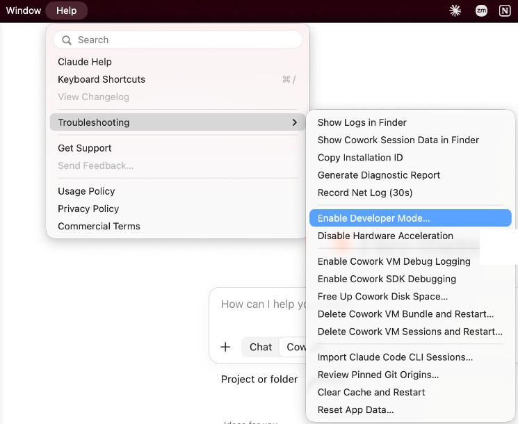
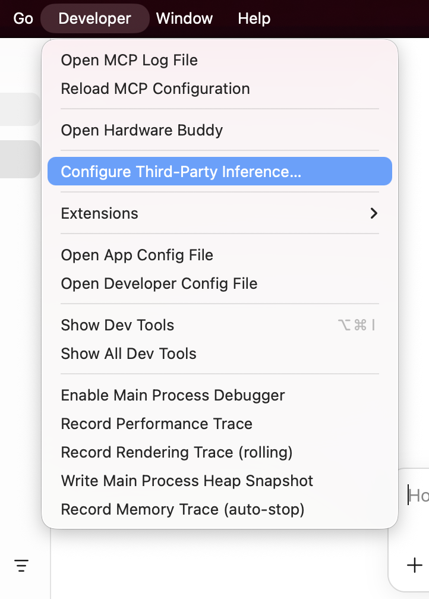
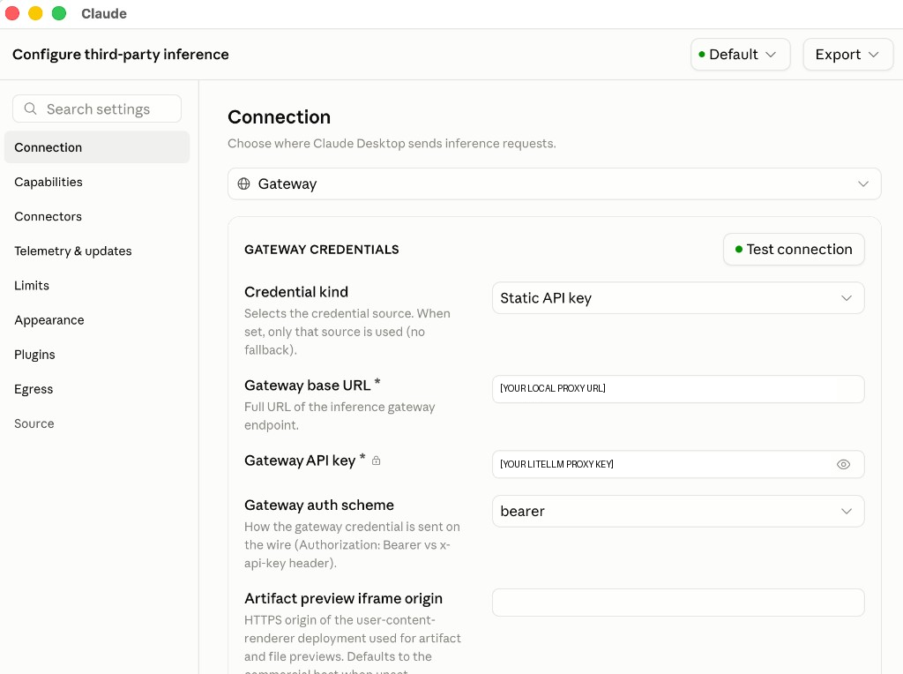
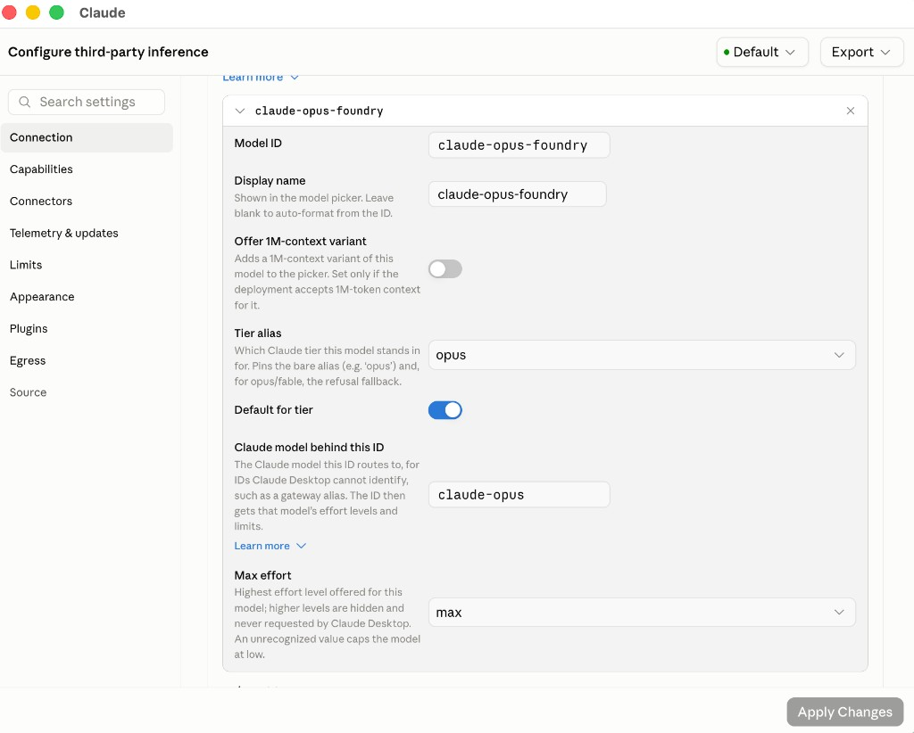
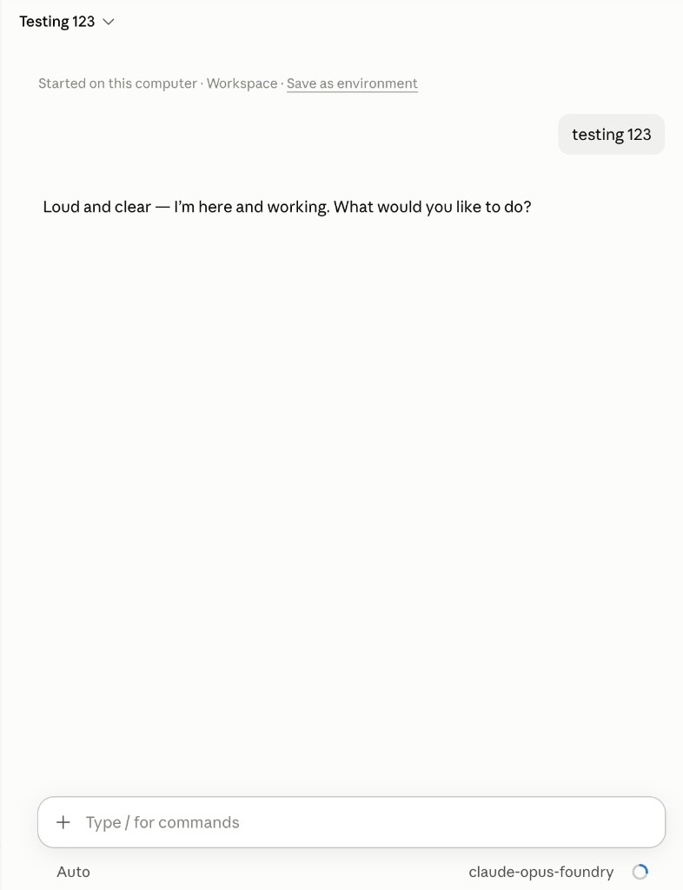

# Fireworks on Microsoft Foundry, through LiteLLM

Use **Claude Code → local LiteLLM proxy → Fireworks model deployments in Microsoft Foundry**, with Azure resource credentials and Azure billing. Claude Desktop setup is included as an optional, version-dependent path.

LiteLLM receives Anthropic Messages requests and translates them to Foundry's OpenAI-compatible Chat Completions API. This is **not** a native Claude deployment, a direct Fireworks API connection, or a claim that an open model has Claude's capabilities. The `claude-…-foundry` names are local routing labels only.

**Status:** reference integration. Offline checks can run without credentials; live Foundry and Desktop validation require your own environment. No customer API key, inference base URL, or deployment ID is embedded in tracked files. Public documentation and software-download URLs are intentionally included.

## Use one Foundry deployment for every Claude model

Set `FOUNDRY_MODEL` to your exact Azure deployment name in the ignored `.env`, alongside `FOUNDRY_API_KEY`. It overrides all three per-role deployment settings. Leave it empty to keep the per-role mappings.

`config.yaml` also accepts `claude-*` requests so Desktop's built-in and background model IDs route to that deployment (or the Sonnet deployment when no single-model override is set). This wildcard does not match unrelated model names and does not forward the incoming Claude ID as the Azure model. The actual deployment mapping remains local, not in Git. Restart the proxy after changing `.env`.

Explicit aliases are only necessary for requests outside the `claude-*` namespace.

## 1. Prepare your machine and Foundry deployment

Use macOS or Linux. Windows users can run the scripts and Claude Code in WSL; native Windows is not supported by these scripts. A Windows Desktop app may require additional WSL networking configuration and is not validated here.

Install:

- Python **3.11+**, with `venv` and `pip` (on some Linux distributions these are separate OS packages).
- Node.js **22+**, npm, and Git, for the repo-local Nexus installation.
- [Claude Code](https://code.claude.com/docs/en/setup), installed separately and available as `claude` on your PATH.
- Optional: a Claude Desktop build with third-party inference settings enabled. An organization policy or app version may hide this feature.

In [Microsoft Foundry](https://ai.azure.com/):

1. Select the correct subscription, resource, and project.
2. Deploy a Fireworks model that supports **Chat Completions, streaming, and tool/function calling**. See [Fireworks models on Foundry](https://learn.microsoft.com/en-us/azure/foundry/how-to/fireworks/enable-fireworks-models).
3. Open the deployment's consume/sample-code page. Copy the **OpenAI v1 API base URL**, not the portal URL or a complete request URL. It must end in `/openai/v1` (an optional trailing slash is accepted). Use the exact resource or project-scoped base in your sample. Do not include `/chat/completions`, `/responses`, query parameters, or a provider passthrough path. The scripts deliberately do not guess or rewrite your endpoint.
4. Copy the **Foundry resource API key** into your password manager. This is an Azure key, not a Fireworks API key. Keyless Entra authentication is not implemented in this reference.
5. Record the exact **deployment name** from the sample's `model` field. Do not use a `fireworks_ai/` provider prefix or a Fireworks catalog resource path.
6. For the simplest setup, use **one deployment for every Claude role** by setting `FOUNDRY_MODEL`. Alternatively, leave it empty and choose deployments for Sonnet (default), Opus, and Haiku (background work). These labels do not change the underlying model.
7. Choose a local HTTP proxy base: loopback host (`127.0.0.1` or `localhost`) and an explicit unused port between 1024 and 65535, without a path. You will type the complete URL during setup; no inference URL is supplied by this repository.

## 2. Run the single setup script

From this repository's root:

```bash
python3 setup.py
```

The script asks for a single deployment name (or optional per-role mappings), the two base URLs, and the Foundry key (hidden input). It then:

1. Validates the inputs and generates a random `sk-` proxy credential if none exists.
2. Writes private local configuration to ignored `.env` with POSIX mode `0600`.
3. Installs a pinned Nexus CLI revision under `.local/nexus`, with lockfile-based npm dependencies and lifecycle scripts disabled.
4. Creates `.venv` and installs the pinned LiteLLM proxy dependency.

It does **not** start a server, perform inference, log in to Nexus, install Claude Code, edit shell profiles, or overwrite global Claude settings. Re-running retains existing values and the proxy key, and retries dependency installation. To change values, edit `.env` locally and rerun setup. See [the setup companion](setup.README.md) for every implementation detail, option, and security boundary.

**Nexus's role:** the CLI is installed as requested and can be run with `./nexus.sh --help`. LiteLLM, not Nexus, provides the protocol translation in this Foundry workflow. Do not run `nexus claude` or `nexus claude-desktop on` for this configuration: those commands manage a separate connection path and can replace your harness settings.

For an unattended setup, copy `.env.example` to `.env`, populate its blank fields using JSON-quoted strings, and run:

```bash
python3 setup.py --non-interactive
```

Leave `LITELLM_MASTER_KEY` empty to generate one. Do not pass keys as command-line arguments. Environment variables with the documented names can also supply the inputs; these override `.env` and are persisted by setup. `.env` is a data file: **do not `source` it**.

## 3. Start LiteLLM

```bash
python3 runtime.py start
```

Leave this terminal open. It runs in the foreground; press Ctrl+C to stop it. Only the loopback interface is bound. The host and port come from your local configuration. No database or Redis is required for this single-user reference.

For a remote/shared gateway, do not simply change the bind address. TLS, scoped virtual keys, a database, authorization, rate limits, budgets, audit logging, and a deployment threat model are separate production work.

## 4. Verify the proxy before using Claude

In a second terminal, from this repository:

```bash
python3 smoke_test.py --allow-billable
```

**This can make seven billable inference requests.** It checks rejection of an invalid proxy key (a master-key-only proxy without a database rejects unknown keys with HTTP 400, which counts as passing), model discovery, text responses and Anthropic SSE streams on all three routes, and a forced tool call on the Sonnet route. No actual tool is executed. Failed checks return a nonzero exit status; private upstream error bodies are withheld.

Expected output is a sequence of `PASS` messages ending in `Smoke tests passed`. Stop here if a check fails. Passing does not prove full Claude compatibility, tool-result round trips, image support, context size, token counting, prompt caching, extended thinking, or Anthropic-hosted tools.

Offline checks (no install or cloud credentials needed):

```bash
python3 -m unittest discover -s tests -v
```

## 5. Connect Claude Code

Keep the proxy running, then launch Claude Code through the scoped wrapper:

```bash
python3 runtime.py claude
```

Arguments are forwarded to Claude Code:

```bash
python3 runtime.py claude --model claude-opus-foundry
```

The wrapper sets `ANTHROPIC_BASE_URL` to your local proxy URL and `ANTHROPIC_AUTH_TOKEN` to the **proxy key**, not the Azure key. It sets the default model and the Sonnet/Opus/Haiku aliases to the three names in `config.yaml`. Background Haiku traffic is therefore also routed to Foundry. It removes competing provider/auth environment variables in the child only and disables nonessential Claude Code traffic. It also points `CLAUDE_CONFIG_DIR` at a repo-local directory (`.local/claude-config`) so a user-level `~/.claude/settings.json` — for example a Nexus or other gateway config with its own auth headers — cannot override the proxy settings (this broke auth during live testing). A side effect: wrapped sessions don't see user-level MCP servers or settings; add any you need to `.local/claude-config/settings.json`. It does not edit or disable your existing user, project, or managed settings. Inspect those for conflicting `env` values, `apiKeyHelper`, model restrictions, and provider policies if requests route elsewhere.

1. Start a **new** session through the wrapper; do not resume an old provider's conversation for your first check.
2. Use `/model` and verify the selected route is `claude-sonnet-foundry` (or the explicit alternative).
3. Ask for a short text reply.
4. In a disposable working directory, ask it to inspect a file and confirm any tool invocation follows your normal permission policy.
5. Observe proxy requests locally. Do not use model self-identification as evidence of the actual upstream: verify deployment selection in your Foundry metrics/usage.

Built-in `claude-*` IDs already route through the wildcard to `FOUNDRY_MODEL` (or the Sonnet deployment in per-role mode). IDs outside that namespace require a deliberate `router_settings.model_group_alias` mapping. A client-side “unrecognized model” warning can also mean Claude Code lacks capability/context metadata for the local alias; it does not necessarily mean proxy routing failed. Verify the upstream model's real context limit rather than assuming Claude's limits.

**Return to normal:** quit the wrapped session and run `claude` normally from your usual terminal. This repo never changes global settings. Any configuration you changed separately must be reverted separately.

## 6. Optional: configure Claude Desktop

The screenshots below were supplied from a macOS Claude Desktop installation on October 29, 2026. They show the actual third-party inference UI and a responding test conversation; app versions and organization policies may change the available settings. The exact Desktop build was not recorded. Screenshots are cropped/redacted for publication. Do not confuse an MCP server configuration with an inference gateway; MCP settings do not redirect model calls.

1. Start and smoke-test the proxy on the **same machine** as Desktop.
2. If available in your app, open **Help → Troubleshooting → Enable Developer Mode**.

   

3. Open **Developer → Configure Third-Party Inference**. If absent, stop and confirm feature availability with your administrator; do not modify undocumented app files.

   

4. Run this locally to view non-secret connection values:

   ```bash
   python3 runtime.py desktop-values
   ```

5. In **Connection**, select **Gateway** as the provider and **Static API key** as the **Credential kind**. Paste your local **Gateway base URL**, and choose **bearer** as the **Gateway auth scheme**. Do not append `/v1/messages`.
6. To obtain the gateway key, explicitly reveal the **local proxy key** in a private terminal:

   ```bash
   python3 runtime.py desktop-values --show-key
   ```

   Paste it into **Gateway API key**, then click **Test connection**. Never use your Foundry key here; clear any clipboard history according to your organization's policy. Do not capture this terminal or the populated key field in screenshots. The screenshot deliberately replaces both the URL and key with explanatory labels—enter your actual local values, not these labels.

   

7. In the model configuration further down the Connection page, add the exact model IDs `claude-sonnet-foundry`, `claude-opus-foundry`, and `claude-haiku-foundry`. Suggested display names are “Foundry — default”, “Foundry — advanced”, and “Foundry — background”. These names describe roles, not capabilities.

   Set each **Tier alias** to its corresponding `sonnet`, `opus`, or `haiku` tier and enable **Default for tier** for the intended default. The example below shows the Opus route. The **Claude model behind this ID** field is a client capability hint—not your Foundry deployment name and not evidence that the upstream is Claude. The screenshot shows `claude-opus` and **Max effort: max** as the contributor's settings; do not assume those capabilities are supported by your deployment. Leave **Offer 1M-context variant** off unless you have verified that context limit end-to-end.

   

8. Click **Apply Changes**, fully quit Desktop (including its tray/menu-bar process), then relaunch it.
9. Select a Foundry route and send a short text message. The supplied screenshot shows a responding conversation with `claude-opus-foundry` selected. Confirm requests reach LiteLLM and usage appears under the expected Foundry deployment; the UI alone does not prove upstream identity.

   

10. Background `claude-*` requests are covered by the wildcard route. Do not assume the model picker controls every internal call. For an unrecognized ID outside that namespace, add a deliberate explicit alias rather than a global catch-all.

See [screenshot provenance and redaction notes](docs/screenshots/README.md).

To switch back, clear/disable the gateway through the same UI, apply changes, and fully restart Desktop. Feature availability and account-backed features can differ in third-party mode. Image/document uploads, Cowork, thinking, and server-side tools have not been validated for this Foundry path.

## Troubleshooting

- **Setup fails before installation:** confirm all required fields, Python 3.11+, Node 22+, npm, and Git. Run `python3 setup.py --help`. Endpoint values must meet the shapes described above; validation intentionally does not print private values.
- **Installation failed after saving `.env`:** fix the package/network/prerequisite problem and rerun setup. Existing credentials and proxy key are retained. Never share raw installer output without review (private package-index configuration can appear in tool errors).
- **Connection refused:** keep `runtime.py start` running; verify the configured loopback URL and port. If occupied, stop the owning service yourself or choose a different port, then reconfigure clients. Scripts never kill unrelated processes.
- **Proxy 401/403:** use the local proxy key from `.env`, not the Foundry key. Restart LiteLLM after rotating it and update Desktop. The wrapper reads it at every launch.
- **Upstream 401/403:** verify the Azure resource key, correct endpoint/resource pairing, resource permissions, and network access. A Fireworks API key will not work.
- **404:** verify the OpenAI v1 base and exact deployment name. Do not paste a portal/project management URL or full operation URL. No legacy Azure `api-version` parameter is added.
- **400 / unsupported parameter:** translation does not make every Claude capability available. `drop_params` is intentionally false so unsupported behavior is visible. Determine the unsupported feature before making a targeted change; do not globally discard fields without review.
- **429:** check Foundry quotas and deployment capacity. This reference does not configure fallback or a retry policy; dependency-level retry behavior can still apply.
- **Tool or stream check fails:** use a deployment that supports the feature and inspect its API contract. Do not proceed to a coding-agent session until both work. Reasoning models may exhaust the test's 1,024-token output budget; adjust it deliberately and account for cost.
- **Agentic tool turns fail with upstream `invalid_payload`:** replayed assistant thinking is being forwarded as reasoning fields. The included `reasoning_history_hook.py` normally prevents this; confirm it's registered under `litellm_settings.callbacks` and the proxy was restarted. See [setup.README.md](setup.README.md) for the trade-offs.
- **Context errors:** route names do not grant Claude's context window to the underlying model. Confirm its actual limits and configure client compaction appropriately; this repo does not invent context metadata.
- **Claude ignores the proxy:** inspect inherited/project/managed settings, provider selectors, helpers, and organization restrictions. Do not run Nexus harness commands over this configuration.

## Security and publication

- `.env`, `.local`, `.venv`, logs, and Python caches are ignored. Ignore rules are not a secret scanner. Review staged files before any publication; never force-add local configuration.
- Keys and inference URLs are only collected at runtime. The Foundry key belongs on the proxy side; Claude receives only a proxy credential. Both remain plaintext in local process memory, and `.env` is plaintext on disk. Restrictive permissions are not encryption.
- The local proxy key is a LiteLLM **master key** for a single-user demo, not a scoped developer virtual key. Do not share it or expose this proxy publicly.
- Prompt logging callbacks and LiteLLM telemetry are disabled, but upstream services, SDK errors, client settings, and access logs may still contain sensitive material. Never share unreviewed logs or screenshots.
- This repo sets no global cloud credentials, does no automatic discovery of your accounts, and copies no keys or customer URLs from another project.
- No license grant or official support relationship is implied. Choose an appropriate repository license with the owning organization before external distribution.

## Documentation

- [Setup implementation and detailed LiteLLM configuration](setup.README.md)
- [LiteLLM: Claude Code client setup](https://docs.litellm.ai/docs/proxy/client_setup/claude_code)
- [LiteLLM: OpenAI-compatible providers](https://docs.litellm.ai/docs/providers/openai_compatible)
- [Claude Code: LLM gateways](https://code.claude.com/docs/en/llm-gateway)
- [Claude Code: model configuration](https://code.claude.com/docs/en/model-config)
- [Fireworks Nexus CLI](https://docs.fireworks.ai/nexus/cli)
